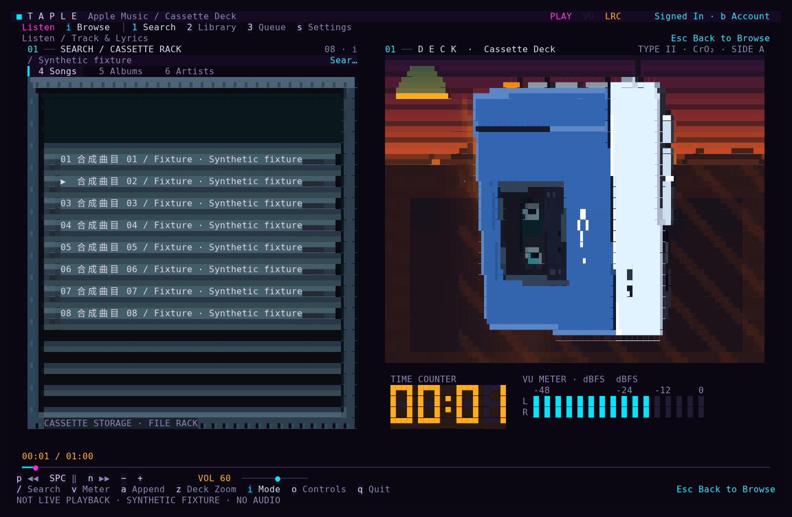
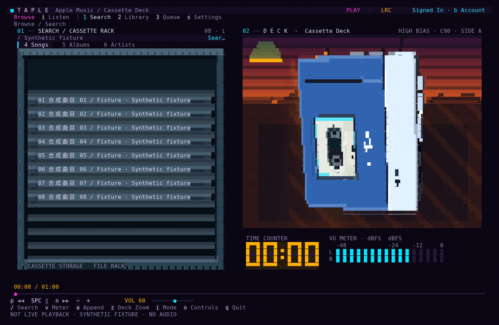
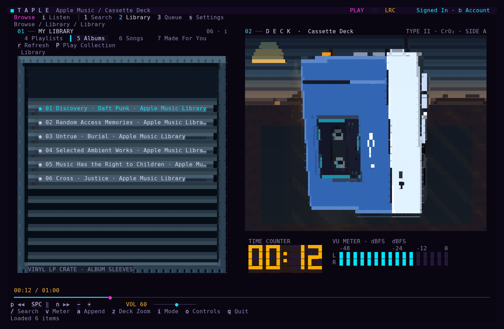
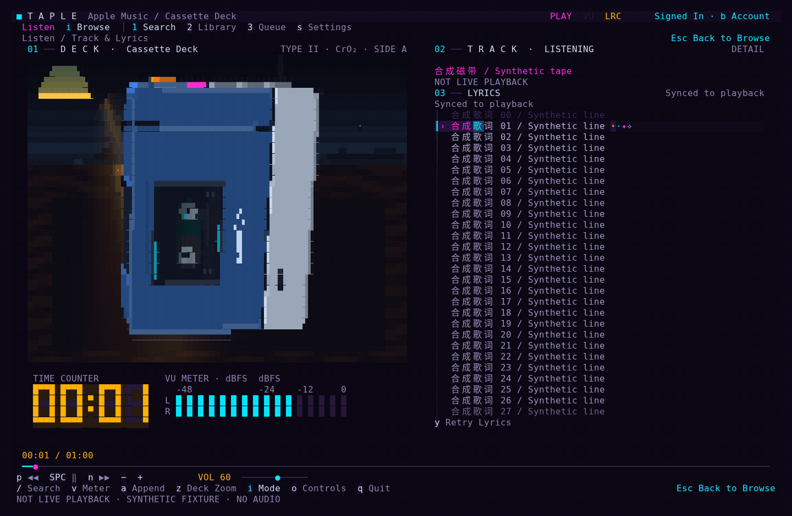
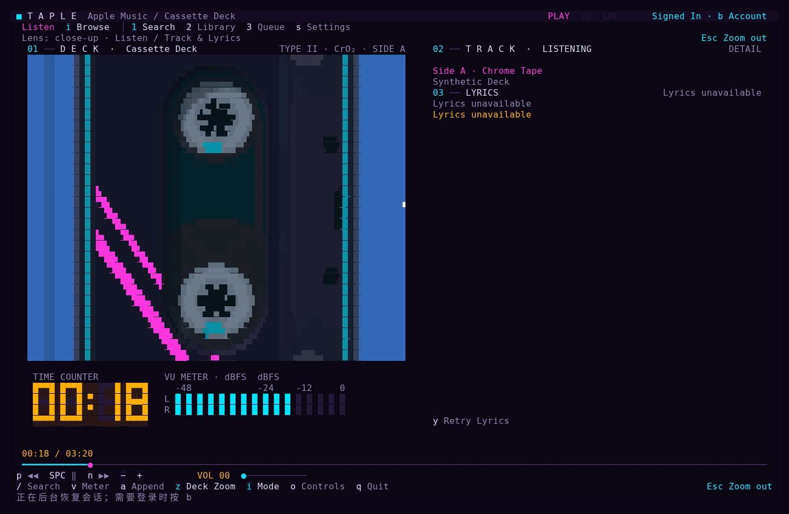

# taple-tui

面向桌面的 Apple Music 终端播放器，使用块字符实时渲染蓝银 Walkman 磁带卡座（TPS-L2 比例）。支持 Linux、Windows 与 macOS。名称结合 **Tap**e（磁带）、App**le**（Apple Music）与 **TUI**。

[English](README.en.md) · [Releases 下载](https://github.com/IoriAkatsuki/taple-tui/releases)



## 功能与界面

- 曲库搜索与浏览：支持歌曲、专辑、歌手搜索，支持歌手→专辑→歌曲层级浏览、分页加载、队列末尾追加与前 50 项跳播。
- 个人资料库：支持歌单、专辑、歌曲、推荐分组与个人电台浏览及播放，支持按 `P` 顺序播放整张专辑或歌单，点播成功后开启原生自动续播。
- 拟物容器与卡座：歌曲与队列使用双行磁带收纳架（单张半弹出、拿起显色），专辑使用黑胶唱片箱，歌单与歌手使用 3D 铰链档案夹；桌面背景随早、中、傍晚、夜间四个时段变化。
- 同步歌词与电平：曲目切换后自动读取 TTML 歌词，聆听页提供滚筒滚动与行内进度粒子；底部提供双声道 dBFS 电平表与数码管计时器。

| 磁带收纳架与取带换带 | 资料库（黑胶唱片箱 / 3D 档案夹 / 队列） |
| :---: | :---: |
|  |  |

| 聆听页（带盘运转 / 同步歌词 / VU 电平） | 切歌换带、设置与账户面板 |
| :---: | :---: |
|  |  |

## 安装与运行

运行需要图形桌面、Chrome（或具备 Widevine DRM 的 Chromium）以及有效的 Apple Music 订阅。程序默认启用 Vulkan Compute 硬件加速，无可用 GPU 驱动时自动回退至 CPU 渲染。

### 1. 下载 Release 预编译包

前往 [GitHub Releases](https://github.com/IoriAkatsuki/taple-tui/releases) 下载对应平台安装包（含 `SHA256SUMS` 校验文件）：

| 平台 | 架构 | Release 软件包 | 安装与启动方式 |
| :--- | :--- | :--- | :--- |
| Linux (Fedora / RHEL / openSUSE) | `x86_64` | `taple-tui-*.x86_64.rpm` | `sudo dnf install ./taple-tui-*.rpm` 或 `sudo zypper install ./taple-tui-*.rpm` |
| Linux (Debian / Ubuntu) | `x86_64` | `taple-tui_*_amd64.deb` | `sudo apt install ./taple-tui_*_amd64.deb` |
| Linux (通用二进制) | `x86_64` | `taple-tui_*_linux_amd64.tar.gz` | 解压后运行 `./taple-tui` |
| Windows | `x86_64` | `taple-tui_*_windows_amd64.zip` | 解压后在 Windows Terminal (PowerShell) 运行 `./taple-tui.exe` |
| Windows (独立 EXE) | `x86_64` | `taple-tui_*_windows_amd64.exe` | 无需安装，在 PowerShell 中用 `& .\taple-tui_<版本>_windows_amd64.exe` 启动 |
| macOS (Apple Silicon) | `arm64` | `taple-tui_*_darwin_arm64.tar.gz` | 可选 `brew install molten-vk` 启用 GPU，解压后运行 `./taple-tui` |
| macOS (Intel) | `x86_64` | `taple-tui_*_darwin_amd64.tar.gz` | 可选 `brew install molten-vk` 启用 GPU，解压后运行 `./taple-tui` |

### 2. 从源码构建

需要 Go 1.26 或更高版本。

#### Linux

安装 C 编译器和 Vulkan headers（Fedora：`gcc vulkan-headers`；Debian/Ubuntu：`build-essential libvulkan-dev`）：

```sh
make build
./bin/taple-tui                   # 启动播放器（同时生成 ./bin/tapefox 软链）
./bin/taple-tui --pure            # 使用临时配置与临时浏览器目录
CGO_ENABLED=0 make build          # 构建纯 CPU 版本
```

#### Windows (PowerShell)

安装 Go 以及 MSYS2 UCRT64 的 `mingw-w64-ucrt-x86_64-gcc` 与 `mingw-w64-ucrt-x86_64-vulkan-headers`，并将 `C:\msys64\ucrt64\bin` 加入 `PATH`：

```powershell
$env:CC = 'gcc'
$env:CGO_ENABLED = '1'
./hack/build.ps1 build
./bin/taple-tui.exe
```

EXE 是命令行便携程序，不是图形安装器；运行时无需 Go、MSYS2 或编译工具。建议在 Windows Terminal 中启动，而不是双击。发布包未进行代码签名，Windows 可能显示未知发布者提示。Chrome 和有效 Apple Music 订阅仍需单独准备。

在 PowerShell 中测试并生成 Windows Release（ZIP、独立 EXE 和各自的 SHA-256 校验文件）：

```powershell
go test ./...
go vet ./...
./hack/release-windows.ps1 -Version v1.1.0
Get-FileHash ./dist/taple-tui_v1.1.0_windows_amd64.exe -Algorithm SHA256
```

维护者推送 `v*` 版本标签后，GitHub Actions 会在所有原生平台检查通过后自动发布 Release，包含 Windows EXE / ZIP 与 `SHA256SUMS`；普通分支构建只上传 Actions artifacts，不创建 Release。

#### macOS

安装 Xcode Command Line Tools，并通过 Homebrew 安装 Vulkan headers 与 MoltenVK（提供 Vulkan 到 Metal 转换）：

```sh
brew install go vulkan-headers molten-vk
export CGO_CFLAGS="-I$(brew --prefix vulkan-headers)/include"
make build
./bin/taple-tui
```

### 3. 打包发布产物

```sh
make package                      # 生成当前平台的 dist/taple-tui_<ver>_<os>_<arch>.tar.gz (或 .zip) 及 .sha256
make rpm                          # 在 Linux 上构建 dist/taple-tui-*.rpm
```

### 平台差异说明

- 窗口管理：Linux 后台 Chrome 使用 Ozone headless 虚拟窗口；Windows 与 macOS 使用请求最小化的独立 Chrome 窗口以保留标准 DRM 播放行为。
- 音频电平：系统混音 VU 电平表目前仅支持 Linux（依赖 `parec` 与 PulseAudio / PipeWire）。
- GPU 加速：按 `s` 可查看当前启用的 GPU 名称或 CPU 回退原因。macOS 通过实例级 `VK_EXT_layer_settings` 自动关闭 Metal Argument Buffers 以保持驱动稳定。

## 常用操作

- `/` 或 `1`：聚焦搜索框；方向键或 `j/k` 移动光标；`Enter` 或单击曲目播放。
- `1/2/3` 或 `Tab`：切换搜索、资料库、队列抽屉；`a` 将当前选中歌曲追加到播放队列末尾。
- 搜索页 `4/5/6`：切换歌曲、专辑、歌手；资料库 `4/5/6/7/8`：切换歌单、专辑、歌曲、推荐、个人电台。
- `Enter` 打开专辑、歌手或歌单；`Backspace` 返回上一层；`P` 从头播放当前集合；`r` 刷新列表；`l` 加载更多。
- `i`：切换浏览与聆听场景；`z` 或点击机身：切换局部近景。
- `Space`：播放/暂停；`p/n`：上一首/下一首；`←/→`：快退/快进；`-/+`：调节音量。
- 聆听页 `↑/↓`、`j/k`、`PgUp/PgDn` 或滚轮：手动滚动歌词；`f`：恢复歌词自动跟随；`y`：重新加载歌词。
- `v` 或点击电平表区域：开启或关闭 VU 电平表。
- `b`：未登录时打开可见浏览器窗口登录；已登录时打开“清空本机登录”确认框（按 `y` 确认，`Esc`/`n` 取消，`Shift+B` 强制打开）。
- `s`：打开操作与设置面板（可切换中/英文）；`Esc`：逐级关闭面板、退出近景或返回上层；`q` 或 `Ctrl+C`：退出。

## 配置与本地路径

程序从系统配置目录下的 `go-musicfox/config.toml` 或 `$MUSICFOX_ROOT/config.toml` 读取设置（Linux 为 `$XDG_CONFIG_HOME` 默认 `~/.config`，macOS 为 `~/Library/Application Support`，Windows 为 `%APPDATA%`）：

```toml
[main]
motion = "full"       # full / subtle / off
blockGlyphs = "auto"  # auto / half / quadrant / sextant / octant / braille
frameRate = 60        # 1..240
```

配置文件缺失时直接使用上述默认值。

- 浏览器会话：Chrome 通过 `--remote-debugging-pipe` 私有管道通信，独立 profile 位于上述系统配置目录下的 `tapefox/apple-music/chrome`（Unix 权限 `0700`，Windows 使用当前用户独占 ACL）。
- 音频采样：Linux 下 VU 电平表通过 `parec` 读取 PulseAudio / PipeWire 的 `@DEFAULT_MONITOR@` 系统混音输出并计算 RMS dBFS。

## 开发与测试

```sh
go test ./...
go test -race ./internal/applemusic ./internal/ui
go list -deps ./cmd
make package
```

修改 `third_party/foxful-cli` 后需运行 `make vendor` 同步 `vendor/` 目录。

## 致谢与许可

本项目派生自 [tapefox](https://github.com/Egdon/tapefox)，早期 TUI 框架源自 [go-musicfox](https://github.com/go-musicfox/go-musicfox) 与 [foxful-cli](https://github.com/anhoder/foxful-cli)（作者 [@anhoder](https://github.com/anhoder)）。Go 模块路径保留 `github.com/go-musicfox/go-musicfox`。

感谢以下开源项目与社区：

- [Charmbracelet](https://charm.land/)（[Bubble Tea v2](https://github.com/charmbracelet/bubbletea)、[Bubbles v2](https://github.com/charmbracelet/bubbles)、[Lipgloss v2](https://github.com/charmbracelet/lipgloss)、[Ultraviolet](https://github.com/charmbracelet/ultraviolet)、[x/ansi](https://github.com/charmbracelet/x)）：终端渲染缓冲与事件循环。
- [lucasb-eyer/go-colorful](https://github.com/lucasb-eyer/go-colorful) 与 [fogleman/ease](https://github.com/fogleman/ease)：色彩插值与缓动曲线。
- [pelletier/go-toml/v2](https://github.com/pelletier/go-toml)、[gookit/gcli/v2](https://github.com/gookit/gcli)、[mattn/go-runewidth](https://github.com/mattn/go-runewidth) 与 [rivo/uniseg](https://github.com/rivo/uniseg)：配置解析、命令行路由与宽字符排版。
- Khronos Vulkan Compute、MoltenVK、Chromium、PulseAudio / PipeWire 以及 [LINUX DO 社区](https://linux.do/)。

采用 [GPL-3.0-only](LICENSE) 许可证发布。
