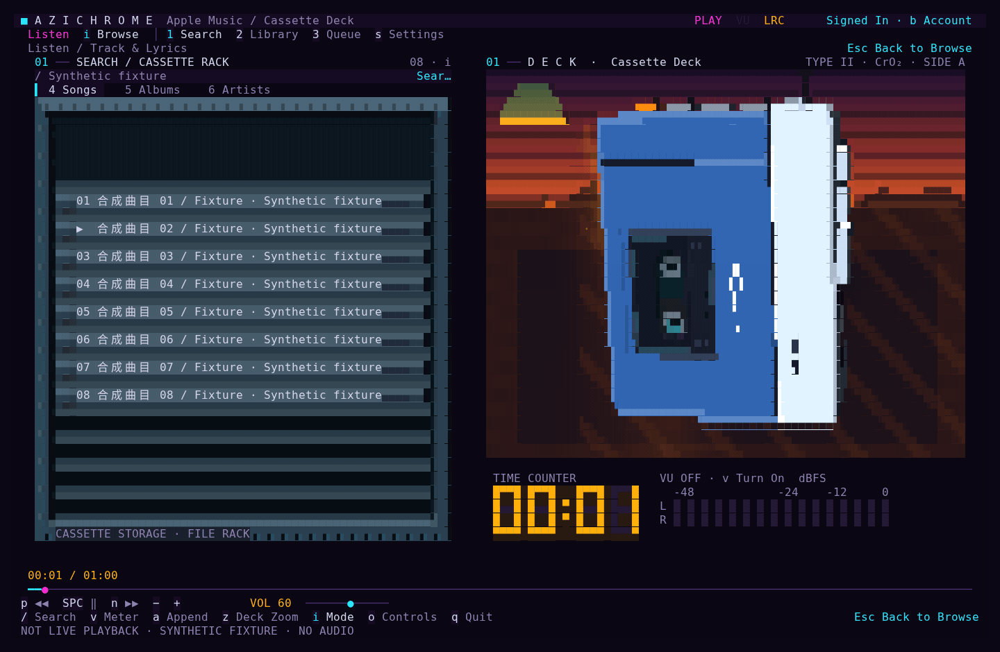
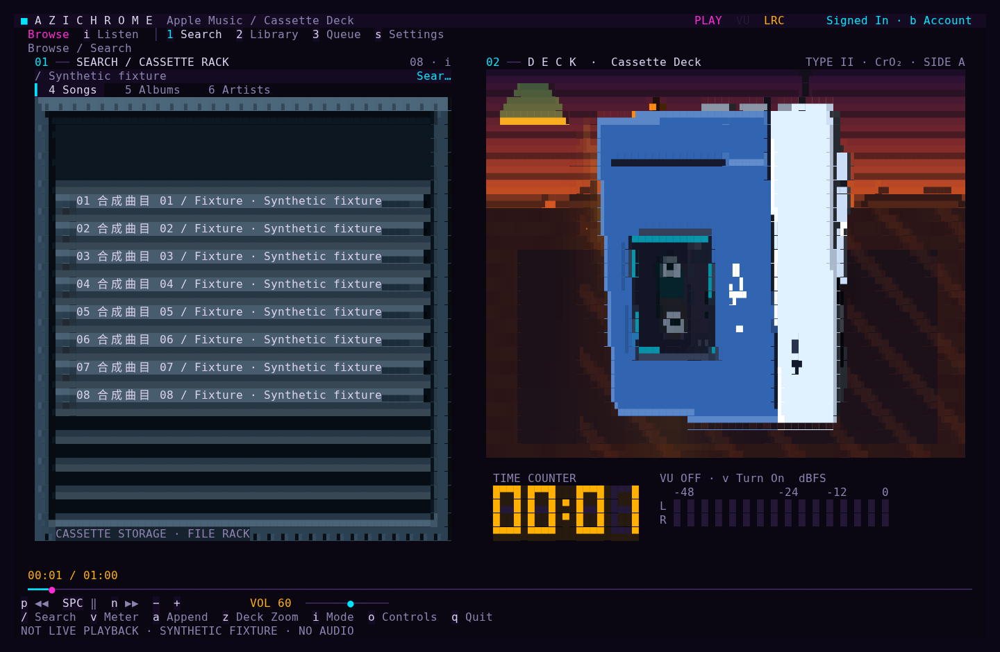
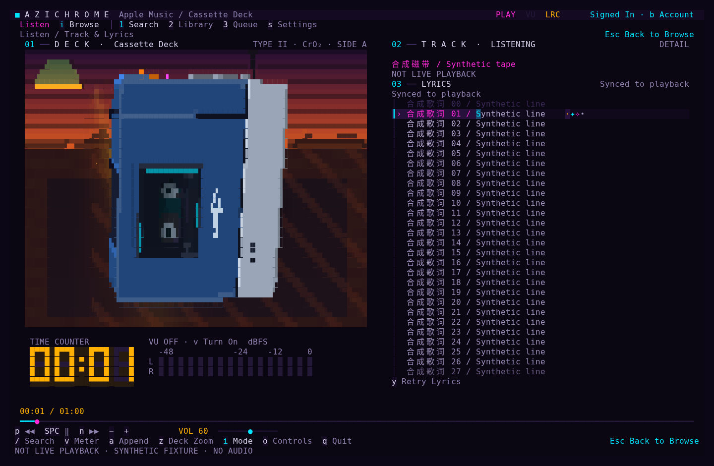
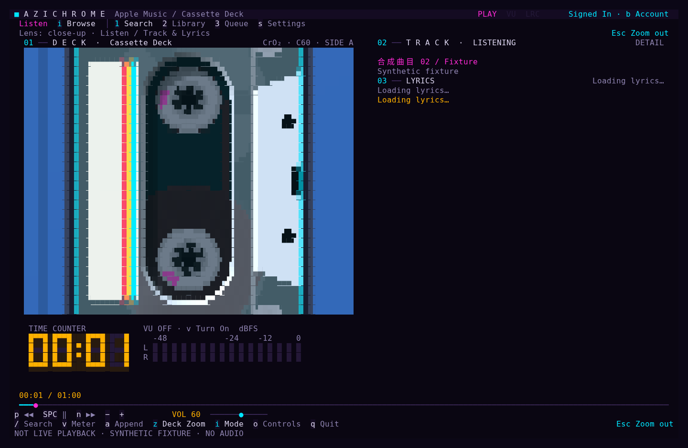

# azichrome-tui

面向 **Linux 桌面**的 Apple Music TUI 播放器，采用经典蓝银 Walkman 磁带卡座（TPS-L2 工业比例）的实时 3D 块字符光线投射渲染。

> **Name Origin (`azichrome-tui`)**：**Azi**muth（磁带机磁头方位角精密调校） + **Chrome**（Type II $\text{CrO}_2$ 二氧化铬磁带 / Chromium Native Pipe 桥接） + **TUI**（Terminal User Interface）。
>
> 本项目直接演进自 **[tapefox](https://github.com/Egdon/tapefox)**，底层框架承接自 **[go-musicfox](https://github.com/go-musicfox/go-musicfox)**。

[English](README.en.md)

本仓库仅发布当前版本的源码快照、测试与演示资源，不包含开发历史、中间工程记录或本机登录数据。后续发布同样使用独立快照，不从开发仓库推送历史分支或标签。

---

## 界面与动效演示 (Screenshots & Demos)

*注：以下静态帧与动态 GIF 均由 `internal/ui` 真实终端字符显存（Framebuffer）直接导出，不经过外部滤镜修饰。*

### 1. 装带入仓与局部特写时间轴 (`1280ms` 入仓 + 自动推进近景)



### 2. 双主场景与局部镜头对比

| 浏览场景（磁带收纳架 + 3D 卡座） | 聆听场景（3D 卡座 + TTML 粒子波前歌词） |
| :---: | :---: |
|  |  |

| 局部特写近景（Close-up 磁带观察窗与带盘） | 磁带收纳架（单张半弹出、拿起显色与连续装带） |
| :---: | :---: |
|  |  |

---

## 当前范围

- **曲库与搜索**：已接入官方曲库歌曲 / 专辑 / 歌手搜索，歌手→专辑→歌曲浏览与分页、播放控制、队列末尾追加与前 50 项跳播、后台 Chrome 与可见登录窗口交接。
- **个人资料库**：已接入个人歌单、专辑、歌曲、推荐分组和个人电台；支持分页、返回、刷新及歌曲/集合/电台播放。库 ID 与曲库 ID 严格分开处理，通过真实 resource 的 `playParams` 交由 SDK 播放。
- **双场景与拟物机械 UI**：浏览与聆听两个主场景、统一深蓝灰配色的双行固定槽位磁带收纳架（无焦点全收纳、单张半弹出、确认拿起后随机分配材质并绑定入仓、先退旧带再装新带）、待机呼吸光晕、设备区域内近景（Close-up）和公共播放控件；视觉时间轴与后台网络请求结果分离，绝不延迟控制或伪造成功。
- **TTML 同步歌词**：曲目变化后自动在浏览器会话内预取 TTML，聆听页提供滚筒平滑滚动、未播浅色层级与播放中行内粒子进度波前（`·✧◇*`）。
- **连续播放与自动续播**：专辑/歌单内点歌保留集合上下文，从所选曲目继续播放整个集合；`P` 从头播放。明确点播成功后开启 Apple Music 原生自动续播，队列结束后由服务端接续；`s` 面板显示实际开关/不支持状态。
- **专注纯粹边界**：默认启动直接进入 Apple Music；已移除历史网易云命令、旧播放器、旧菜单、本地 SQLite 数据库和跨平台媒体集成。

---

## 构建、RPM 打包与运行

### 运行环境要求

- **操作系统**：Linux 图形桌面（需要本地安装的 Chrome，或具备所需 DRM 能力的 Chromium）。首次登录需要可见浏览器窗口；无图形 SSH、macOS、Windows 不在当前支持范围。播放器不会提取音频直链，也不绕过 Apple Music 账户或订阅限制。
- **编译环境**：Go 1.26。默认构建启用 Vulkan Compute 加速，需要 C 编译器和 Vulkan headers（Fedora：`gcc vulkan-headers`；Debian/Ubuntu：`build-essential libvulkan-dev`）。运行时需要 Vulkan loader 和实体显卡驱动；不需要 shader 编译器。

### 源码构建与运行

```sh
make build
./bin/azichrome-tui               # 默认启用 VU 电平，播放后自动加载歌词（同时提供 ./bin/tapefox 兼容软链）
./bin/azichrome-tui --pure        # 使用临时配置与临时 Chrome profile
./bin/azichrome-tui --help
```

### Fedora / openSUSE / RHEL 构建与安装 RPM 包

仓库内置了适配现代 RPM 规范的 `deploy/rpm/azichrome-tui.spec` 与打包脚本（包含 `/usr/bin/azichrome-tui`、`/usr/bin/tapefox` 兼容软链、桌面 `.desktop` 启动器以及 `pulseaudio-utils` / `vulkan-loader` 弱依赖推荐）：

```sh
# 本地编译并打包生成 dist/azichrome-tui-<version>.x86_64.rpm
make rpm

# 在 Fedora / RHEL 上安装
sudo dnf install ./dist/azichrome-tui-*.rpm

# 在 openSUSE Tumbleweed 上安装
sudo zypper install ./dist/azichrome-tui-*.rpm
```

### 运行机制说明

- `apple-music` 是唯一显式子命令，与无参数启动使用同一路径。`--debug` 开启调试日志。
- 电平默认尝试开启，歌词随真实曲目自动加载，无需额外启动参数（`--vu` 已移除）。
- 无参数启动会在后台异步初始化 Vulkan，使用实体独显或集显计算 Walkman 机身及弹出/飞行磁带的光线投射，最终仍输出终端字符。按 `s` 查看实际 GPU 名称或 CPU 回退原因。不会将 `lavapipe` 等软件实现标为 GPU；初始化或运行失败明确回退 CPU。使用 `CGO_ENABLED=0 make build` 可构建纯 CPU 版本。
- 后台 Chrome 使用 `--remote-debugging-pipe` 私有双向管道，不开放任何本地调试端口；`--ozone-platform=headless` 提供虚拟原生窗口。仅在用户请求登录时切换到可见窗口，检测到授权后自动回到后台。程序只关闭自身启动的浏览器进程，绝不干预用户的日常浏览器。

---

## 常用操作

- **搜索与导航**：`/`、`1` 或点击搜索入口打开可见搜索框并聚焦；方向键或 `j/k` 选择，回车或单击有效曲目播放，悬浮不触发播放。
- **搜索分类**：`4/5/6` 选择歌曲 / 专辑 / 歌手搜索（也可点击分类）；回车或单击专辑/歌手进入列表，`Backspace` 或面包屑“返回”恢复上层，`l` 加载更多。容器不触发播放。
- **抽屉切换与入队**：`1/2/3` 或 `Tab` 切换搜索、资料库、队列抽屉；`1` 同时聚焦搜索，`Tab` 不自动聚焦。搜索编辑中先按 `Esc` 再用快捷键切换，或直接点击导航；`a` 将选中的可播放歌曲追加到播放队列（不修改云端歌单）。
- **个人资料库**：资料库内 `4/5/6/7/8` 切换歌单 / 专辑 / 歌曲 / 推荐 / 个人电台。回车进入集合或播放歌曲/电台，`P` 播放选中或已打开的歌单/专辑，`r` 强制刷新，`l` 加载更多。
- **场景与镜头**：`i` 切换浏览/聆听场景，`z` 或点击机身切换局部近景（Close-up）。
- **歌词交互**：聆听页 `↑/↓`、`j/k`、`PgUp/PgDn` 或歌词区滚轮手动浏览；`f` / “回到当前句”恢复自动跟随，纯文本歌词则回到顶部；`y` 显式重试歌词。标题区分加载、纯文本、手动浏览、真实同步/暂停及同步暂不可用；试听、过期播放状态或缺少完整时间戳时不伪造同步。
- **播放控制**：空格播放/暂停，`p/n` 上一首/下一首，左右方向键请求 seek，`-/+` 调整音量。
- **VU 电平表**：默认开启；`v` 或点击 VU 区域关闭/重新开启，无需重启。`VU OFF` 表示已关闭，`VU ERR` 表示采样失败，可按 `v` 重试。
- **账户与设置**：`b` 登录，`s` 打开操作与设置说明；`Esc` 按界面提示依次关闭面板、退出搜索编辑、拉远近景、返回浏览，再取消目录等待或返回父层。面板支持鼠标切换中/英文语言，关闭后保留原上下文；`q` 或 `Ctrl+C` 退出。
- **清空本机登录**：已登录时点击顶部账户或按 `b` 打开“清空本机登录”确认框；按 `y` 或点击“清空并退出”后停止播放、清空专用 Chrome 会话，之后按 `b` 重新登录。`Esc` / `Enter` / `n` 取消；设置中的 `B` 或非输入状态下的 `Shift+B` 也可强制打开确认框（包括会话失效时）。终端小于 40 列或 12 行时必须先放大窗口才能确认。

---

## 配置与数据边界

只读 `$XDG_CONFIG_HOME/go-musicfox/config.toml`（默认 `~/.config/go-musicfox/config.toml`），或 `$MUSICFOX_ROOT/config.toml` 中的三个设置：

```toml
[main]
motion = "full"       # full / subtle / off
blockGlyphs = "auto"  # auto / half / quadrant / sextant / octant / braille
frameRate = 60        # 1..240
```

- **只读与零入侵配置**：文件缺失时使用上述内存默认值，不创建、升级或覆盖用户配置文件；未知旧键保留但不再驱动旧功能。历史旧数据、Cookie、下载和数据库不会读取、迁移或删除。
- **独立浏览器会话**：Apple Music 独立 Chrome profile 位于 `$XDG_CONFIG_HOME/tapefox/apple-music/chrome`（默认 `~/.config/tapefox/apple-music/chrome`），权限固定为 `0700`，保持与 `tapefox` 会话路径兼容。程序不导出 Cookie、Token 或密码。
- **本地退出语义**：“清空本机登录”仅通过 `os.Root` 安全清空本程序启动的专用 profile 内容，保留目录及 `0700` 权限；不清理其他浏览器、旧用户数据库、播放器配置或云端资料库。它是本地退出，不代表撤销 Apple 服务端授权。普通 `q` / `Ctrl+C` 退出仍保留登录。
- **系统混音采样边界**：启动时默认通过 `parec` 采样 PulseAudio / PipeWire 的 `@DEFAULT_MONITOR@`，可按 `v` 停止。它是**系统混音（包含其他应用）**，不是 Apple Music 独立音轨；不采集麦克风、不落盘。显示 RMS dBFS（非 LUFS 响度），请求 50ms 采样延迟，超过 300ms 无新样本时清空电平并提示不可用；关闭或不可用时绝不产生假信号。

---

## 开发与验证

```sh
go test ./...
go test -race ./internal/applemusic ./internal/ui
go list -deps ./cmd
make rpm
```

真实浏览器/登录/播放测试是显式 opt-in，默认单元测试不会代替它们。视觉验收使用 `internal/ui` 实际 framebuffer 导出，覆盖不同尺寸、场景与时间轴。重建 vendor 时必须执行 `make vendor` 以保持 `third_party/foxful-cli` 与 `vendor/` 的一致性。

---

## 友链、致谢与开源许可 (Attribution & Acknowledgments)

`azichrome-tui` 站在众多优秀开源项目的肩膀上构建，特此向以下项目、作者与社区致谢：

### 核心源流与友链

- **[tapefox](https://github.com/Egdon/tapefox)**：本项目的直接前身与上游演进分支，奠定了 Linux 桌面 Apple Music 专用桥接、双行磁带收纳架、3D Walkman 光线投射渲染与 Vulkan Compute 加速架构。
- **[go-musicfox](https://github.com/go-musicfox/go-musicfox)**（作者：[@anhoder](https://github.com/anhoder)）：项目最初的 TUI 音乐客户端基因底座；为保持模块与构建稳定性，Go 模块路径保留 `github.com/go-musicfox/go-musicfox`（不代表旧版网易云兼容承诺）。
- **[foxful-cli](https://github.com/anhoder/foxful-cli)**（作者：[@anhoder](https://github.com/anhoder)）：提供核心的 TUI 应用宿主、帧调度节拍器与视图容器架构（仓库内维护于 `third_party/foxful-cli`）。

### 致谢开源依赖与技术生态

- **[Charmbracelet 生态](https://charm.land/)**：
  - [Bubble Tea v2](https://github.com/charmbracelet/bubbletea) & [Bubbles v2](https://github.com/charmbracelet/bubbles)：遵循 Elm 架构的现代化 Go 终端 UI 状态机与输入组件。
  - [Lipgloss v2](https://github.com/charmbracelet/lipgloss) & [Ultraviolet](https://github.com/charmbracelet/ultraviolet) & [x/ansi](https://github.com/charmbracelet/x)：提供高性能终端虚拟显存（Cell Buffer）、24-bit TrueColor 样式合成与 ANSI 序列处理。
- **图形、色彩与缓动计算**：
  - [lucasb-eyer/go-colorful](https://github.com/lucasb-eyer/go-colorful)：色彩空间插值与色阶过渡计算。
  - [fogleman/ease](https://github.com/fogleman/ease)：磁带弹出、飞行入仓与镜头推拉的物理缓动函数。
  - **Khronos Group Vulkan Compute**：提供跨显卡的 SPIR-V 计算着色器标准，驱动终端半块/八分块字符的实时 3D 光线投射。
- **配置、CLI 与宽字符排版**：
  - [pelletier/go-toml/v2](https://github.com/pelletier/go-toml)：只读 TOML 配置文件解析。
  - [gookit/gcli/v2](https://github.com/gookit/gcli)：命令行参数与子命令路由。
  - [mattn/go-runewidth](https://github.com/mattn/go-runewidth) & [rivo/uniseg](https://github.com/rivo/uniseg)：Unicode 字素簇分割与中日韩（CJK）宽字符单元格精确对齐。
- **桌面运行环境与社区**：
  - **Chromium / Google Chrome**（Native `--remote-debugging-pipe` & Ozone Headless）与 **Apple MusicKit JS**。
  - **PulseAudio / PipeWire (`parec`)**：提供零入侵的 Linux 桌面系统混音监测能力。
  - **[LINUX DO 社区](https://linux.do/)**：感谢社区伙伴在复古磁带机 TUI 形态探索过程中的交流、反馈与支持。

### 许可证与免责声明

本项目遵循 **[GPL-3.0-only](LICENSE)** 开源许可证发布。
`azichrome-tui` 不是 Apple、Sony、`tapefox` 或 `go-musicfox` 的官方产品，不代表上述品牌或权利人的支持、合作或背书。机身建模致敬经典便携磁带机工业设计，界面与机身不展示受保护的商业商标。
